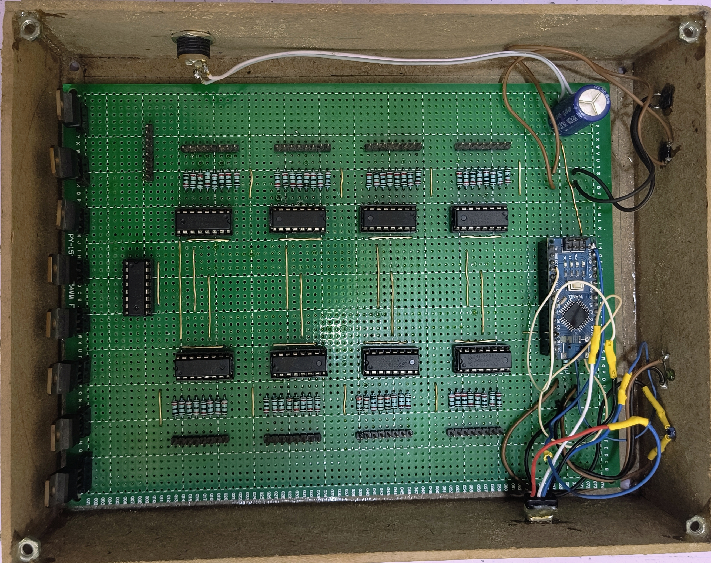
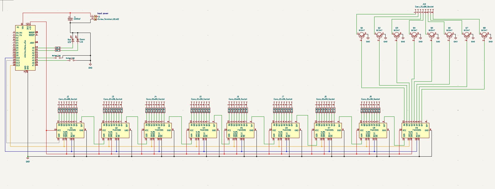

# 🧊 8×8×8 LED Cube (512 LEDs)

An interactive **8×8×8 monochromatic LED Cube consisting of 512 LEDs** controlled using an **Arduino Uno and 74HC595 shift registers**. The cube generates dynamic 3D volumetric lighting patterns and animations through multiplexing techniques and custom Arduino firmware.

The system demonstrates fundamental concepts of **digital electronics, shift-register cascading, transistor layer switching, and 3D LED multiplexing**.

---

## 📷 Project Demo



---

## 📐 Circuit Schematic

The cube utilizes 74HC595 shift registers for column control and NPN transistors for layer ground switching.



---

## ✨ Features

- **512 LEDs** arranged in a 3D $8 \times 8 \times 8$ matrix (8 horizontal layers of 64 columns).
- Cascaded **74HC595 shift registers** reduce pin requirement to just 3 Arduino control pins (`DATA`, `LATCH`, `CLOCK`).
- Transistor layer switching enables fast multiplexing.
- Custom **3D lighting animations and patterns** (rain, waves, cube expansions, spinning planes).
- Optimized refresh timing utilizing **Persistence of Vision (POV)** for flicker-free illumination.

---

## 🛠️ Hardware Components

| Component | Quantity | Description |
| :--- | :--- | :--- |
| **Arduino Uno** | 1 | Main microcontroller unit |
| **Blue Diffused LEDs** | 512 | Form the 3D lattice |
| **74HC595 Shift Registers** | 8 | 8-bit serial-in, parallel-out column drivers |
| **NPN Transistors / MOSFETs** | 8 | High-current ground switching per layer |
| **Current Limiting Resistors** | 64 | 220Ω / 330Ω resistors for each column |
| **Power Supply** | 1 | 5V / 2A–4A regulated DC adapter |
| **Soldered Matrix Grid** | 1 | Custom 8×8 jig-soldered scaffolding |

---

## ⚙️ Working Principle

The cube is structured into **8 horizontal layers (anodes or cathodes common)** with **64 vertical columns**:

1. **Shift Register Cascading:** Eight 74HC595 shift registers are daisy-chained (`Q7'` $\rightarrow$ `SER`) to control all 64 columns using only 3 SPI pins from the Arduino.
2. **Layer Multiplexing:** Only one layer is activated at a time by switching its corresponding transistor.
3. **Rapid Cycling (POV):** The Arduino shifts in the 64-bit column pattern for Layer 0, turns on Layer 0, delays briefly, turns off Layer 0, and repeats for Layers 1 through 7.
4. Due to **Persistence of Vision (POV)** at $>60\text{ Hz}$, the human brain perceives the entire 3D structure as continuously illuminated.

---

## 📂 Repository Structure

```text
8x8x8-LED-Cube-512-LEDs-/
├── Circuit_Diagram/
│   └── schematic.png         # Full schematic diagram
├── Images/
│   ├── IMG_20251017_153454881_AE.jpg
│   ├── IMG_20251018_210157.jpg  # Working hardware demonstration
│   └── IMG_20251018_210223.jpg
├── Video/
│   └── IMG_0043.mp4          # Video clip of 3D animation patterns
├── Code.ino                  # Main Arduino firmware with animation routines
├── LICENSE                   # MIT License
└── README.md                 # Project documentation
```

---

## 🚀 Setup & Upload

1. Open [`Code.ino`](Code.ino) in Arduino IDE.
2. Connect your Arduino Uno via USB.
3. Select board **Arduino Uno** and the corresponding COM port.
4. Upload the code and verify that the layers cycle cleanly.

---

## 📄 License

This project is licensed under the [MIT License](LICENSE).
